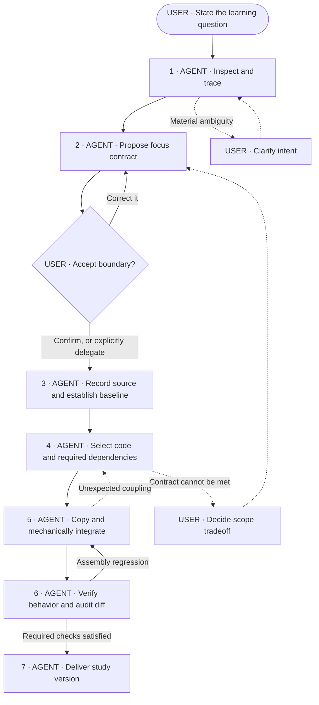

# Codebase Focus

Assemble a focused, runnable study version in an isolated worktree by copying
the selected flow and its dependencies from the original codebase.
Prioritize fidelity to the original implementation over reducing code size.
Copy code unchanged wherever possible; limit edits to necessary mechanical
integration changes and explain deviations from the source.

The deliverable is the study codebase. Guided learning and refactoring are
separate uses of that result.

## Example requests

- “Keep popup launch through eligibility so I can learn where code runs.”
- “Isolate scanning so I can inspect its current React state handling.”
- “Keep checkout and its dependencies so I can examine its coupling.”

A rough question is enough to begin inspection. The user does not need
to supply a file list or technical plan.

## Workflow

User confirmation already supplied in the request counts. Do not request
it again. Explicit delegation allows the agent to choose the boundary.
Silence does not confirm a proposal.

Any new evidence that requires changing the contract returns to Step 2.
Pause affected assembly work until that decision is resolved.

## Step conditions

Each step requires the preceding postcondition, plus the conditions below.
These are evidence gates, not automatic requests for user approval.

| Step | Precondition | Postcondition |
|---|---|---|
| 1. Inspect | Repository access and initial intent. | Code-backed scope proposal; assumptions and consequential uncertainties identified. |
| 2. Align | Enough evidence to propose a concrete boundary. | Contract aligned with the user; no ambiguity that could materially change the selection. |
| 3. Baseline | Accepted source state. | Source state recorded and recoverable; existing failures recorded; required verification feasible. |
| 4. Select | Dependency evidence and baseline available. | Selected code and supporting dependencies identified; uncertain dependencies retained; necessary integration edits identified. |
| 5. Assemble | Isolated worktree available and no unresolved scope blocker. | Reviewable assembly copied from the recorded source; deviations limited to necessary mechanical integration changes. |
| 6. Verify | Assembled candidate and agreed checks available. | Verification requirements met; source deviations audited; no unresolved assembly regressions; claims match evidence. |
| 7. Deliver | Verification postcondition satisfied. | Focused study codebase delivered with scope, source provenance, and verification evidence. |

## Focus contract

Keep the contract concise:

- **Question:** What does the user want to investigate?
- **Start → finish:** Where does the selected flow begin and end?
- **Scenarios:** Which successful, empty, failure, and lifecycle cases remain?
- **Evidence:** Which implementation details or coupling must stay visible?
- **Exclusions:** Which behavior is outside the assembled scope?
- **Verification:** What must still build, run, or pass?

Describe the boundary in observable terms. For example:

> Include opening the popup, scanning, eligibility, and scan failures.
> Exclude saving and library management. Current React state handling
> and the Chrome injection boundary remain unchanged.

Ask only when competing interpretations would materially change the selection.
Infer routine details by inspecting the repository.

## Source state and assembly workspace

Inspect the source checkout and record the source commit before copying.
If uncommitted changes could affect the selected code, resolve whether they
belong in the source state. Preserve any included changes in a recoverable
snapshot; HEAD alone is insufficient.

Assemble in a separate, isolated worktree, leaving the source checkout
untouched. Populate it with selected source files rather than checking out
the full application and deleting unwanted code. Do not overwrite an
existing study version or unrelated work.

Record which paths were copied and which required edits, with reasons,
so the assembly can be compared against its source.

## Assembly boundaries

- Read and follow repository instructions.
- Preserve dependency setup, tooling, and read-only references unless
  explicitly authorized otherwise.
- Trace runtime dependencies as well as imports: registration, messages,
  permissions, configuration, assets, and generated files.
- Preserve relevant failure handling, cleanup, security checks, side
  effects, and execution boundaries.
- Copy whole files unchanged wherever possible, preserving their relative
  paths. When selected and excluded code share a file, limit edits to the
  separation and integration necessary for the agreed scope.
- Prefer including a required dependency to rewriting the selected code
  to avoid it. Do not rename, reorganize, redesign, or substitute copied logic.
- Do not introduce stubs, mocks, or hardcoded results to bypass dependencies.
- Include uncertain dependencies. Retain shared infrastructure when needed; its
  coupling may be evidence the user wants to study.
- Check whether existing data requires retained schemas or migrations.
  Do not assume an empty store.
- Do not change shared services or host configuration, or publish, push,
  or merge as an implied part of this task.

If keeping a dependency satisfies the contract, keep it and explain why.
Ask about a tradeoff only when the contract cannot otherwise be met.

## Verification

Run repository-required and contract-required checks. Compare against
the baseline and exercise the retained scenarios as agreed.

Compare copied files against the recorded source. Explain each modified
file and verify that its changes are necessary for assembly, not a rewrite
of the selected implementation.

Restore missing dependencies or mechanically repair assembly regressions,
then recheck.
Never delete a relevant failing test merely to pass.

If required verification becomes impossible, resolve the prerequisite
or revisit the contract. Do not silently waive the requirement.

Distinguish build/test success from behavior actually exercised, including
whether startup was tested through the real entry point or test fixtures.

## Handoff and stopping rule

Report:

- Included focus and excluded scope.
- Worktree location, source state, and execution entry point.
- Copied paths and explanations of deviations from the source.
- Significant retained dependencies and reasons.
- Verification evidence, limitations, and recovery instructions.

Identify relevant implementation choices and coupling without turning
the handoff into an unsolicited redesign.

Keep the assembly focused without sacrificing fidelity to reduce line count.
Every included component belongs to the focus, supports execution or
verification, or has an explicit reason to remain.

Stop after delivering the verified study version. Guided learning and
refactoring are separate work.
