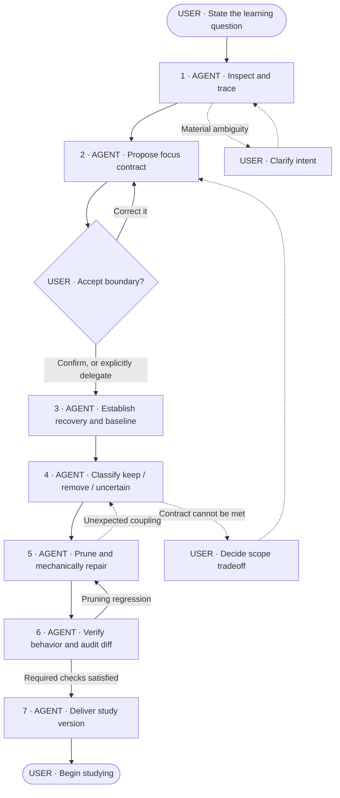

# Codebase Focus

Remove unrelated scope so the user can study the existing implementation.
Preserve the evidence needed to understand its behavior and design.
Do not perform refactoring.

## Example requests

- “Keep popup launch through eligibility so I can learn where code runs.”
- “Isolate scanning so I can inspect its current React state handling.”
- “Keep checkout and its dependencies so I can examine its coupling.”

A rough question is enough to begin inspection. The user does not need
to supply a file list or technical plan.

## Workflow

User confirmation already supplied in the request counts. Do not request
it again. Explicit delegation allows the agent to choose the boundary.
Silence does not confirm a proposal.

Any new evidence that requires changing the contract returns to Step 2.
Pause affected deletions until that decision is resolved.

## Step conditions

Each step requires the preceding postcondition, plus the conditions below.
These are evidence gates, not automatic requests for user approval.

| Step | Precondition | Postcondition |
|---|---|---|
| 1. Inspect | Repository access and initial intent. | Code-backed scope proposal; assumptions and consequential uncertainties identified. |
| 2. Align | Enough evidence to propose a concrete boundary. | Contract aligned with the user; no ambiguity that could materially change the cut. |
| 3. Baseline | Accepted working state. | Starting state recoverable; existing failures recorded; required verification feasible. |
| 4. Classify | Dependency evidence and baseline available. | Each removal justified; supporting and uncertain parts retained; mechanical repairs identified. |
| 5. Prune | Recovery established and no unresolved scope blocker. | Reviewable reduction; retained implementation preserved. |
| 6. Verify | Reduced candidate and agreed checks available. | Verification requirements met; no unresolved pruning regressions; claims match evidence. |
| 7. Deliver | Verification postcondition satisfied. | User can follow the selected flow; remaining components have reasons to stay. |

## Focus contract

Keep the contract concise:

- **Question:** What does the user want to investigate?
- **Start → finish:** Where does the selected flow begin and end?
- **Scenarios:** Which successful, empty, failure, and lifecycle cases remain?
- **Evidence:** Which implementation details or coupling must stay visible?
- **Exclusions:** Which behavior disappears?
- **Verification:** What must still build, run, or pass?

Describe the boundary in observable terms. For example:

> Opening the popup, scanning, eligibility, and scan failures remain.
> Saving and library management disappear. Current React state handling
> and the Chrome injection boundary remain unchanged.

Ask only when competing interpretations would materially change the cut.
Infer routine details by inspecting the repository.

## Starting state and recovery

Default to a clean worktree. Inspect status before making changes.

If it is dirty, explain that pruning would mix with existing changes.
Ask whether the user wants to proceed there or establish a clean starting
point. Do not stash, commit, discard changes, or create another worktree
without that decision.

Before deletion, establish a recoverable starting point. If proceeding
with uncommitted changes, account for them too: HEAD alone is insufficient.

## Pruning boundaries

- Read and follow repository instructions.
- Preserve dependency setup, tooling, and read-only references unless
  explicitly authorized otherwise.
- Trace runtime dependencies as well as imports: registration, messages,
  permissions, configuration, assets, and generated files.
- Preserve relevant failure handling, cleanup, security checks, side
  effects, and execution boundaries.
- Make necessary mechanical repairs caused by deletions. Do not rename,
  reorganize, redesign, or substitute surviving logic.
- Do not introduce stubs, mocks, or hardcoded results to bypass dependencies.
- Keep uncertain parts. Retain shared infrastructure when needed; its
  coupling may be evidence the user wants to study.
- Check whether existing data requires retained schemas or migrations.
  Do not assume an empty store.
- Do not change shared services or host configuration, or publish, push,
  or merge as an implied part of this task.

If keeping a dependency satisfies the contract, keep it and explain why.
Ask about a tradeoff only when the contract cannot otherwise be met.

## Verification

Run repository-required and contract-required checks. Compare against
the baseline and exercise the retained scenarios as agreed.

Restore or mechanically repair pruning regressions, then recheck.
Never delete a relevant failing test merely to pass.

If required verification becomes impossible, resolve the prerequisite
or revisit the contract. Do not silently waive the requirement.

Distinguish build/test success from behavior actually exercised.

## Handoff and stopping rule

Report:

- Retained focus and removed scope.
- Execution entry point and reading order, with code references.
- Significant retained dependencies and reasons.
- Verification evidence, limitations, and recovery instructions.

Identify relevant implementation choices and coupling without turning
the handoff into an unsolicited redesign.

Minimal means minimal relative to the contract—not minimum line count.
Every remaining component belongs to the focus, supports execution or
verification, or has an explicit reason to remain.

Stop after delivering the study version. Refactoring is separate work.
